# AudioPipeline

[](https://github.com/yoohooshantanu/voicepipe/actions/workflows/ci.yml)
[](https://go.dev/)
[](https://redis.io/)
[](https://en.wikipedia.org/wiki/Pulse-code_modulation)

A streaming audio buffer manager and distributed asynchronous post-call workflow orchestrator written in Go. It is designed to solve two distinct operational problems in telephony voice AI: ingesting out-of-order raw audio chunks in sub-microsecond time (~617 ns) with a sliding monotonic sequence frontier, and orchestrating multi-stage post-call AI jobs (audio stitching, transcription, LLM summarization, CRM webhook sync) with worker leases, exponential retries, and dead-letter queue (DLQ) isolation.

I wanted to build the reliable bridge between live streaming audio and background AI processing: the service that makes sure packets arriving out-of-order are stitched seamlessly, and long-running post-call jobs do not disappear when an LLM worker crashes.

*(The GitHub repo is called voicepipe. The Go module and binary are named audio-pipeline from a later rename.)*

## Contents

- [The idea in two minutes](#the-idea-in-two-minutes)
- [What is real and what is mocked](#what-is-real-and-what-is-mocked)
- [Streaming ingestion & DAG workflow pipeline](#streaming-ingestion--dag-workflow-pipeline)
- [The pieces, one by one](#the-pieces-one-by-one)
- [API specification](#api-specification)
- [Run it](#run-it)
- [Observability](#observability)
- [Tests](#tests)
- [Performance](#performance)
- [Limitations and rough edges](#limitations-and-rough-edges)
- [Repo map](#repo-map)
- [Author](#author)

---

## The idea in two minutes

Voice AI systems live in two different time domains:
1. **The Real-Time Fast Path (< 1 ms)**: While a call is live, carriers and gateways stream tiny audio frames (PCM or Opus). Packets arrive out-of-order, arrive late, or get duplicated. The ingestion handler must acknowledge frames in nanoseconds, reassemble the stream in memory, and advance a contiguous sequence frontier without blocking or allocating heap memory aggressively.
2. **The Post-Call Async Path (seconds to minutes)**: Once a call finishes, the recorded conversation must undergo multi-stage processing: stitch thousands of audio chunks $\rightarrow$ run speech-to-text transcription $\rightarrow$ summarize the call with an LLM $\rightarrow$ dispatch CRM webhooks. If an external API times out or a container restarts during Step 3, the entire workflow must not vanish or duplicate Step 1.

AudioPipeline pairs both layers in a single service:
- **Streaming Buffer Manager**: Ingests out-of-order chunks in **~617 ns**, advances a monotonic frontier, and produces pre-allocated contiguous audio buffers when the call completes.
- **DAG Workflow Orchestrator**: Executes multi-stage pipelines across distributed worker pools with 30-second leases, step-level checkpointing, exponential backoff retries, and dead-letter queue persistence.

---

## What is real and what is mocked

| Real | Mocked or simplified |
| :--- | :--- |
| **Sub-microsecond frame ingestion**: Out-of-order chunk reassembly and monotonic sequence frontier advancement in ~617 ns. | **AI Models**: The speech-to-text (ASR) and LLM summarization steps in the default pipeline simulate processing latency (sleeps 5–10ms) and emit structured JSON payloads rather than calling external cloud APIs. |
| **Distributed DAG orchestrator**: Multi-stage state machine (`PENDING` $\rightarrow$ `PROCESSING` $\rightarrow$ `COMPLETED` / `DEAD_LETTER`) with step checkpoints. | **Storage**: State store runs in thread-safe process memory by default with 2-hour TTL eviction; production can back the `StateStore` interface with PostgreSQL or DynamoDB. |
| **Two-tiered broker abstraction**: High-throughput in-memory channels for local/embedded use, or distributed Redis Streams (`XADD`, `XREADGROUP`, `XACK`) for clustered fleets. | **Carrier SIP/RTP**: Accepts HTTP binary chunk ingestion (`POST /v1/streams/audio`) rather than raw UDP/RTP telephony packets directly. |
| **Worker leasing & auto-recovery**: 30-second distributed worker leases prevent zombie jobs if a worker dies mid-step. | |
| **Exponential backoff & DLQ**: Up to 3 automatic retries with exponential backoff before isolating failed jobs in `DEAD_LETTER` state. | |
| **Strict lock hierarchy**: `StreamManager.mu > AudioBuffer.mu` enforced to prevent deadlocks under heavy concurrent stream load. | |
| **Continuous memory eviction**: Background eviction loop automatically purges idle streams after 5 minutes of inactivity. | |
| **3 tests & parallel benchmarks**: Verified in CI with live Redis and Go's race detector. | |

*Summary: This is a stream reassembly and resilient workflow orchestration project, not a transcription model.*

---

## Streaming ingestion & DAG workflow pipeline

```mermaid
flowchart TD
    subgraph FastPath ["Real-Time Audio Ingestion (< 1 µs)"]
        A["Telephony Stream: POST /v1/streams/audio"] --> B["StreamManager: GetOrCreate buffer"]
        B --> C["AudioBuffer.IngestChunk(seq, data)"]
        C --> D{"Sequence Check"}
        D -->|seq < frontier| E["Reject duplicate / already acknowledged"]
        D -->|seq >= frontier| F["Store in chunks map"]
        F --> G["Advance Monotonic Frontier (1, 2, 3...)"]
        G --> H["Publish to stream:audio topic (ASR / Live monitoring)"]
        G --> I["Return StreamAck (accepted: true, frontier: N)"]
    end

    subgraph AsyncPath ["Post-Call DAG Orchestrator"]
        J["POST /v1/jobs (post_call_ai_pipeline)"] --> K["SaveJob(StatePending)"]
        K --> L["Broker.EnqueueJob(queue)"]
        L --> M["Worker Pool Dequeue (30s Lease)"]
        
        M --> N["Step 1: Audio Concatenation & Validation"]
        N --> O["Step 2: Speech Transcription & Diarization"]
        O --> P["Step 3: LLM Conversation Summary & Sentiment"]
        P --> Q["Step 4: CRM Sync & Webhook Dispatch"]
        
        Q --> R["SaveJob(StateCompleted)"]
        
        N -.->|Failure| S{"RetryCount <= MaxRetries?"}
        O -.->|Failure| S
        P -.->|Failure| S
        Q -.->|Failure| S
        S -->|Yes| T["Exponential Backoff -> Re-enqueue"]
        S -->|No| U["SaveJob(StateDeadLetter)"]
    end
```



---

## The pieces, one by one

### 1. Monotonic sequence frontier reassembly
Carrier networks deliver audio packets out of order. 
When chunk 2 arrives before chunk 1, the `AudioBuffer`:
1. Stores chunk 2 in an indexed map and records byte counts.
2. Reports `LastAckSeq: 0` because the contiguous frontier has not yet been established.
3. When chunk 1 arrives, the frontier loop advances through 1 and 2, instantly returning `LastAckSeq: 2`.
4. When `X-Stream-Final: true` is set, `AssembleContiguousAudio()` pre-allocates a slice of exact size `totalBytes` and concatenates the stream in a single linear pass with zero intermediate reallocations.

### 2. Lock hierarchy: `StreamManager.mu > AudioBuffer.mu`
Under thousands of concurrent calls, improper lock acquisition order creates deadlocks. 
AudioPipeline enforces a strict global invariant:
- **Rule**: Always acquire `StreamManager.mu` before acquiring `AudioBuffer.mu`.
- **Rule**: Never attempt to acquire `StreamManager.mu` while holding an `AudioBuffer.mu` lock.
- Clean separation between session lookup (`StreamManager`) and frame ingestion (`AudioBuffer`) allows parallel frame processing across different calls with zero cross-call lock contention.

### 3. Distributed Redis Streams vs In-Memory broker
The message layer is decoupled behind `broker.MessageBroker`:
- **`MemoryBroker`**: Uses Go buffered channels (`chan *model.PipelineJob`) and mutex-protected subscriber maps. Provides sub-microsecond non-blocking pub/sub drops for slow consumers.
- **`RedisStreamBroker`**: Uses Redis Streams (`XADD` with `MaxLen: 5000`) for audio broadcasting, and Redis Consumer Groups (`XREADGROUP` / `XACK`) for distributed task dispatch across worker fleets.

### 4. DAG workflow engine with 30-second worker leases
When a worker claims a job:
1. It updates the state to `PROCESSING`, records its `WorkerID`, and sets `LeaseExpires = now + 30s`.
2. It executes registered `StepExecutor` functions sequentially. After each successful step, the state store records `CurrentStep = stepIdx + 1`.
3. If an unhandled panic occurs in any step, a deferred recovery handler catches the panic, logs the stack trace, and delegates to the step failure handler without crashing the worker process.

### 5. Exponential backoff retries & Dead-Letter Queue (DLQ)
External APIs (like transcription or LLMs) suffer transient rate limits and network drops:
- When a step fails, the worker increments `RetryCount` and calculates an exponential backoff delay:
  $$\text{Backoff} = 2^{\text{RetryCount}} \times 100\text{ms}$$
- If `RetryCount <= MaxRetries` (3), the job is re-enqueued after the backoff window.
- When retries are exhausted, the job transitions to `DEAD_LETTER` with `LastError` preserved. It remains in the state store for operator inspection and manual redrive.

### 6. Background stream eviction
To prevent memory leaks from abandoned calls or dropped network connections, `StreamManager` runs an eviction loop every 30 seconds:
- Any `AudioBuffer` with no frame activity for longer than `ttl` (default 5 minutes) is deleted from memory.
- Backlog gauges are exported to Prometheus continuously.

---

## API specification

### 1. Ingest audio chunk (Real-time fast path)
`POST /v1/streams/audio`

```bash
curl -X POST http://localhost:8081/v1/streams/audio \
  -H "X-Call-ID: call_live_789" \
  -H "X-Sequence: 1" \
  -H "X-Stream-Final: false" \
  -H "Content-Type: application/octet-stream" \
  --data-binary "@frame_001.raw"
```

**Response (202 Accepted):**
```json
{
  "call_id": "call_live_789",
  "last_ack_seq": 1,
  "buffer_backlog": 1,
  "accepted": true
}
```

### 2. Submit asynchronous pipeline job
`POST /v1/jobs`

```bash
curl -X POST http://localhost:8081/v1/jobs \
  -H "Content-Type: application/json" \
  -d '{
    "call_id": "call_live_789",
    "tenant_id": "cust_enterprise_01",
    "workflow_type": "post_call_ai_pipeline",
    "payload": {
      "recording_url": "s3://telephony-recordings/call_live_789.pcm"
    }
  }'
```

**Response (202 Accepted):**
```json
{
  "id": "job_a1b2c3d4e5f6",
  "call_id": "call_live_789",
  "tenant_id": "cust_enterprise_01",
  "workflow_type": "post_call_ai_pipeline",
  "state": "PENDING",
  "current_step": 0,
  "total_steps": 4,
  "retry_count": 0,
  "max_retries": 3,
  "created_at": "2026-11-19T12:00:00Z"
}
```

### 3. Query job state
`GET /v1/jobs/{job_id}`

```bash
curl -X GET http://localhost:8081/v1/jobs/job_a1b2c3d4e5f6
```

---

## Run it

### Environment variables

| Variable | Default | Description |
| :--- | :--- | :--- |
| `PORT` | `8081` | HTTP API listen port |
| `REDIS_ADDR` | `""` | Redis connection address (omitting runs in high-throughput in-memory mode) |
| `WORKER_CONCURRENCY` | `8` | Number of parallel workflow orchestrator worker goroutines |

### Running locally

```bash
# Clone the repository
git clone https://github.com/yoohooshantanu/voicepipe.git
cd voicepipe

# Run unit tests and benchmarks
go test -v ./tests/...

# Start service
go run ./cmd/server
```

### Running with Docker Compose

```bash
docker compose up -d
```

- **Pipeline Gateway**: `http://localhost:8081`
- **Prometheus Metrics**: `http://localhost:8081/metrics`
- **Health Check**: `http://localhost:8081/healthz`
- **pprof Profiling**: `http://localhost:8081/debug/pprof/`

---

## Observability

AudioPipeline exposes Prometheus metrics at `GET /metrics`:

| Metric | Type | Description |
| :--- | :--- | :--- |
| `audio_pipeline_chunks_ingested_total` | Counter | Total audio chunks received and buffered |
| `audio_pipeline_chunk_bytes_total` | Counter | Total raw audio payload bytes processed |
| `audio_pipeline_active_streams` | Gauge | Currently active telephony audio buffers in memory |
| `audio_pipeline_jobs_enqueued_total` | Counter | Total asynchronous workflow jobs submitted |
| `audio_pipeline_jobs_completed_total` | Counter | Total workflow jobs completed successfully |
| `audio_pipeline_jobs_retried_total` | Counter | Workflow step retries triggered via backoff |
| `audio_pipeline_jobs_dlq_total` | Counter | Jobs routed to Dead-Letter Queue upon retry exhaustion |
| `audio_pipeline_active_workers` | Gauge | Active orchestrator worker goroutines processing jobs |
| `audio_pipeline_job_duration_seconds` | Histogram | End-to-end execution latency of workflow DAGs |

Health check is exposed at `GET /healthz`:
```json
{
  "status": "healthy",
  "active_streams": 14,
  "timestamp": "2026-11-19T12:00:00Z"
}
```

---

## Tests

The test suite exercises concurrent frame ingestion, out-of-order sequence reassembly, parallel execution pipelines, and panic recovery with Go's race detector:

| Test Name | Focus |
| :--- | :--- |
| `TestAudioBufferOrderingAndAssembly` | Validates that out-of-order frames buffer properly, monotonic frontiers advance only when gaps fill, and `AssembleContiguousAudio()` stitches bytes in exact sequential order. |
| `TestWorkflowOrchestratorExecution` | Submits a multi-step job, verifies asynchronous worker dequeue, executes all 4 stages, and confirms state transition to `COMPLETED` with structured step results. |
| `TestConcurrentStreamIngestion` | Ingests 100 frames concurrently across separate goroutines, asserting zero dropped packets and perfect linear assembly under load. |
| `BenchmarkAudioIngestAndAssembly` | Parallel microbenchmark measuring chunk ingestion throughput, heap allocations, and lock overhead. |

Run tests:
```bash
go test -v -race ./tests/...
```

---

## Performance

Microbenchmarks measured via `go test -bench` over multiple parallel iterations on AMD Ryzen 5 (Windows amd64 / Ubuntu x86_64, Go 1.23+):

```text
Benchmark                             Iterations    Time (ns/op)    Memory (B/op)   Allocs (allocs/op)
------------------------------------------------------------------------------------------------------
BenchmarkAudioIngestAndAssembly-8        1867194       639.2 ns/op         145 B/op          2 allocs/op
BenchmarkAudioIngestAndAssembly-8        2854194       568.1 ns/op         144 B/op          2 allocs/op
BenchmarkAudioIngestAndAssembly-8        1864770       644.9 ns/op         145 B/op          2 allocs/op
```

- **Ingestion Latency**: **~617 nanoseconds per audio chunk** (sub-microsecond ingest path).
- **Heap Efficiency**: Only **2 allocations** (145 bytes) per ingested frame on the contiguous write path.
- **Throughput**: Capable of processing over **1.6 million audio chunks per second** per server node.

---

## Limitations and rough edges

- **In-memory buffer boundary**: Audio frames for active calls live in process memory until assembled. The per-call capacity ceiling is `MaxChunksPerCall: 50,000` (approximately 16 minutes of 20ms frames). Calls longer than 16 minutes must stream chunks to persistent object storage or flush in continuous segments.
- **Mocked AI worker steps**: The built-in 4-stage pipeline simulates transcription and LLM inference. In production, developers replace `o.steps["post_call_ai_pipeline"]` with concrete HTTP or gRPC client calls to Whisper, Deepgram, OpenAI, or Anthropic.
- **Single-broker instance binding**: In Redis mode, all stream events publish to the configured `REDIS_ADDR`. It does not currently shard across distinct Redis clusters based on tenant ID.

---

## Repo map

| Path | What it does |
| :--- | :--- |
| `cmd/server/main.go` | HTTP server bootstrap, audio ingestion endpoints, job submission, graceful shutdown |
| `internal/stream/manager.go` | Monotonic audio buffer ordering, sequence frontier advancement, stale stream eviction |
| `internal/broker/broker.go` | `MessageBroker` interface, in-memory buffered pub/sub channels, Redis Streams (`XADD`/`XREADGROUP`) |
| `internal/orchestrator/orchestrator.go` | Multi-stage DAG async workflow engine, 30s worker leasing, retry backoff, DLQ routing |
| `internal/model/types.go` | Domain models: `AudioChunk`, `StreamAck`, `PipelineJob`, `JobState` definitions |
| `internal/metrics/metrics.go` | Prometheus metrics definitions and exposition handler |
| `internal/logger/logger.go` | Structured JSON logging using Go `slog` |
| `tests/pipeline_test.go` | Concurrent buffer reassembly, workflow execution assertions, parallel microbenchmarks |

---

## Author

- **Shantanu Juvekar** ([@yoohooshantanu](https://github.com/yoohooshantanu))
- Email: `santanujuvekar@gmail.com`
- License: MIT
